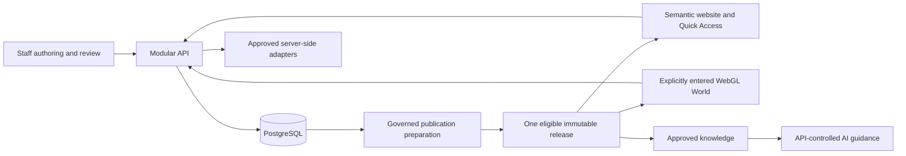

# Hengshi Design v1 — current architecture entry

Status: DOING. Reconciled 2026-10-17. This entry assembles existing decisions and
contract owners for Phase 1 review; it introduces no new component, mechanism,
provider, version selection or implementation permission.

## Read the accepted boundaries with their current amendments

[D-065](../../DECISIONS.md#d-065--accept-phase-1-architecture-authority-and-boundaries)
accepts the exact [architecture baseline](ARCHITECTURE.md) and
[authority map](authority-map.csv) identified by the
[independent boundary review](architecture-review-2026-10-04.md).
Those files remain unchanged. Their pending-approval labels describe the earlier
review point; founder boundary acceptance is already recorded.

Use the current [constitution](../../.specify/memory/constitution.md),
[decisions](../../DECISIONS.md) and
[system boundaries](../software-definition/01-system-boundaries.md) to interpret
that baseline. Detailed contracts are proposed refinements until their applicable
review and acceptance gates are complete. Neither this entry nor a scoped PASS
accepts the complete Phase 1 package.

| Earlier wording or evidence | Current instruction and owner |
|---|---|
| Directed exploration only; no free-roam requirement | D-064/D-065 add mouse/touch free steering and walking alongside destinations, plus nearby spatial streaming and reversal recovery. WASD remains unselected. The [movement addendum](MOVEMENT_STREAMING_ADDENDUM.md) and [World definition](../phase-1-3d/WORLD_EXPERIENCE.md) own the detailed proposals. |
| Azure is the approved production target | D-068 defers hosting, provider, region, SKU and cost planning. Azure and AWS are candidates. Historical Azure service mappings select neither; approved confidential-AI routing constraints remain separate. |
| Constitution 2.0.0 or independently newest dependency observations | D-069 and the current constitution define the first-production v1 package and latest mutually compatible stable graph. Real dependency/schema and historical evidence identifiers stay accurate. The [compatibility package](../phase-1-compatibility/README.md) owns selection, locks, exceptions and rollback. |
| Staff and visitor session clocks read as one policy | D-076 sets visitor access to 30 minutes of inactivity or authorized End, without an absolute visitor duration. Staff clocks and authorization are separate; the security and chat contracts below own them. |
| Registration, address, alias owners or real team/client content are missing founder inputs | D-076 defers public registration/validity/address and alias ownership. Use quarantined fictional non-sensitive local data; real content is managed through admin before production. Required legal notice and launch verification are still obligations. |
| Warning/extension and pre-start timing adjustment treated as the same branch | D-078 accepts the exact timing/source-binding successor. Warning/extension affords at least 20 seconds to act and at least ten extension opportunities; pre-start adjustment retains its separate range rule. This establishes no working timer or accessibility certification. |

## How the components work together

Two primary deployables remain: the React-based web application and modular
FastAPI API. Background/render/index work can run separately while retaining the
API's accepted responsibility and contracts; no additional microservice is
selected. PostgreSQL is durable truth. Redis and search are ephemeral or derived;
generated public artifacts are rebuildable, immutable release derivatives.

The diagram shows responsibility and data relationships, not direct database
access by a browser or a bypass of publication approval. The semantic website
delivers complete indexable HTML before JavaScript. The three WebGL detail streams
and Quick Access preserve equivalent core information and actions. Capability
selection and override are separate from explicit World entry; graphics detail
and nearby-area streaming are separate controls.

The World owns camera, position, collision-safe travel, area residency and enabled
audio playback. It cannot publish content, invent staff availability, confirm a
booking or hold provider credentials. Scene chunks are immutable published
artifacts; movement does not require a database request for every step. The
accepted organic reception/five-wing composition remains a layout basis, with
geometry, final appearance, asset rights and device calibration still required.

API authorization controls staff actions. Entra identifies staff; Hengshi owns
their permissions, application sessions and revocation. Visitor chat/proofs do
not grant staff authority. Human availability, consent and booking outcomes need
authoritative server/provider evidence. Unknown external outcomes remain unknown
until reconciliation; they cannot be represented as successful appointments.

## One owner for each detailed contract

| Subject | Controlling definition |
|---|---|
| Public/private interfaces and directional data | [Interface catalogue](contracts/INTERFACE_CATALOG.md) and its endpoint-specific schemas; [data contract](contracts/DATA_CONTRACT.md) owns record/value and retention bindings. |
| Approval, release eligibility and coordinated derivatives | [Publication contract](contracts/PUBLICATION_CONTRACT.md), including scene/knowledge preparation and activation. |
| Movement, scene residency, collision and audio | [Movement addendum](MOVEMENT_STREAMING_ADDENDUM.md), [World definition](../phase-1-3d/WORLD_EXPERIENCE.md) and [scene assembly contract](../phase-1-3d/SCENE_ASSEMBLY_CONTRACT.md). |
| Staff identity, authorization and privacy lifecycle | [Security/privacy contract](contracts/SECURITY_PRIVACY_CONTRACT.md); [private-process proof](contracts/PRIVATE_PROCESS_PROOF.md) owns visitor proof boundaries. |
| Hengshi staff sessions and own-session controls | [Staff session protocol](contracts/STAFF_SESSION_PROTOCOL.md) owns application clocks, rotation, logout and control directions; the security contract supplies identity/authorization policy. |
| Conversation delivery, continuation and human handoff | [Chat event protocol](contracts/CHAT_EVENT_PROTOCOL.md) and [handoff lifecycle](contracts/HANDOFF_LIFECYCLE.md). |
| Discovery booking and external reconciliation | [Booking scheduling](contracts/BOOKING_SCHEDULING.md), with qualification and email-ownership directions in the interface catalogue. |
| Behavior evidence, failure, restoration and recovery | [QA/recovery contract](contracts/QA_RECOVERY.md) and the approved-requirement-based acceptance matrix. Artifact integrity is separate from application behavior. |
| Versions, provenance, licensing, stable graph and local operation | [Compatibility package](../phase-1-compatibility/README.md) and [native operating guide](../../README.md#native-local-operation-on-windows). Docker is not required locally. |

## Current refinements and their review limits

These links identify the current owners; they do not extend the accepted
architecture baseline or transfer a review verdict to later edits.

| Refinement | Current definition and evidence |
|---|---|
| Staff session controls | The [session owner](contracts/STAFF_SESSION_PROTOCOL.md) and [directional schema](contracts/staff-session-control.schema.json) retain separate [corrected logical](../../output/research/staff-session-controls-2026-10-17/correction-1/independent-review-controls-correction-v1.json) and [canonical binding](../../output/research/staff-session-controls-2026-10-17/canonical-binding/independent-review-canonical-controls-v1.json) PASS receipts. These cover frozen proposal/representation scopes. The new [catalogue registration](../../output/research/staff-session-controls-2026-10-17/catalogue-binding/review-inputs-v1.json) remains unreviewed; no endpoint, signed-token verification or complete session implementation is established. |
| Staff principal and session records | The [DE-06/07 data amendment](contracts/DATA_CONTRACT.md#staff-principalsession-field-binding-proposal--2026-10-17) owns the proposed field and revision-event translation. Its [separate packet](../../output/research/staff-session-data-binding-2026-10-17/review-inputs-v1.json) has no independent verdict; no table, migration or data-model adoption follows. |
| Privacy purposes, notices and copies | The [privacy registry amendment](contracts/SECURITY_PRIVACY_CONTRACT.md#purpose-notice-and-copy-binding-registry-proposal--2026-10-17) and [purpose matrix](contracts/privacy-purpose-bindings.csv) identify proposed responsibilities. Their [separate packet](../../output/research/privacy-purpose-bindings-2026-10-17/review-inputs-v1.json) remains unreviewed. Notice families are not issued notices; no legal-basis, retention-period, recipient or operational-channel approval is implied. |
| World capability observations and workloads | The [measurement owner](../phase-1-3d/WORLD_MEASUREMENT_PROFILE.md#capability-samples-and-workload-registration-proposal--2026-10-17) and [workload matrix](../phase-1-3d/qualification-workloads.csv) retain an [unreviewed proposal](../../output/research/world-capability-workloads-2026-10-17/review-inputs-v1.json). The recipes are not a running classifier or measured device results; physical calibration and acceptance remain. |

## What remains before implementation

Complete the required contract bindings, production visual/3D definitions and
compatible stable graph; reconcile feature specifications through the
[feature index](../../specs/README.md); independently review the coherent package
and obtain founder Phase 1 acceptance. The
[fourteen-deliverable reconciliation map](../software-definition/04-reconciliation-map.md#coverage-against-the-fourteen-phase-1-deliverables)
owns remaining coverage. Deferred hosting and real launch data are not new Phase 1
founder-input blockers. No application development, external design call, account
change, migration, spending, commit, push or deployment follows from this entry.

The original application, Atlanta GLB, accepted campus study and all frozen
review receipts remain evidence with their exact scope. Existing accepted
boundaries and founder choices are not reopened.

The [independent entry review](../../output/research/current-architecture-entry-2026-10-11/independent-review-entry-v1.json)
passes documentation/navigation consistency at its eleven frozen inputs from
2026-10-11, with no
actionable findings. The original baseline and map hashes are preserved. The
review does not independently verify the one-row-only navigation delta, accept
the complete architecture/Phase 1 package or grant implementation permission.
The later receipt link and this 2026-10-17 owner/reference reconciliation are
outside the frozen reviewed entry bytes; neither inherits that PASS.
