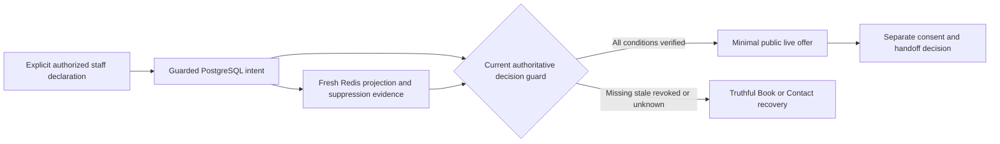

# Availability authority and consistency — v1 proposal

Status: DOING. Primary evidence checked 2026-10-04. Definition only; no service,
handler, identity grant, persistent record, migration or dependency is activated.

This refines FR-009, AF-02/SOF-01A/B in the
[approved journey](../../phase-1-ux-architecture/FLOWS.md), DE-22/DE-18 in the
[logical data contract](DATA_CONTRACT.md), and existing IF-STAFF-09,
IF-PRESENCE-01 and handoff operations in the
[catalogue](INTERFACE_CATALOG.md). Accepted PostgreSQL durable authority and
ephemeral Redis responsibilities remain. This proposed consistency protocol needs
independent review and integrated acceptance; it is not a physical schema or wire
freeze and cannot choose an owner, backup, delegate, account or hosting provider.

## Four different outcomes

| Outcome | What it establishes | What it does not establish |
|---|---|---|
| Command received | A request reached the handling boundary | Authorized intent, committed state or live staff. |
| Declaration durably accepted | The approved actor's guarded intent and operation outcome are known in PostgreSQL | Redis freshness, live offer, a reservation or human response. |
| Live offer verified | Current explicit intent, eligibility and required fresh projection/suppression evidence all pass the authoritative decision guard | A human has accepted this visitor's conversation. |
| Human handoff accepted/responded | The separate consent, assignment and conversation transition has actual authoritative evidence | Publication approval, calendar confirmation or a response-time guarantee. |

SOF-01A's “available after durable accept” is a compound success: durable intent
plus current eligibility and a valid projection, not an acknowledgement alone.
The staff control must expose pending/not-available while those conditions are
unproved. SOF-01B immediately removes the initiating interface's live claim while
withdrawal is pending; a global server-confirmed withdrawal requires the durable
guard described below. A button animation or Redis delete is not that evidence.

## Decision guard and private binding

PROPOSED reference design: each positive IF-PRESENCE-01 result and each new
handoff eligibility decision checks current PostgreSQL authority at its decision
boundary. Redis is evidence for a derived signal, never the sole permission to
offer or route live help. An alternative fenced derivative design would need
independent equivalence proof before acceptance; a TTL or best-effort invalidation
alone cannot replace this guard.

The private binding uses existing department/scope, `setting_id`, revision and
expiry responsibilities. Match both setting identity and revision: a replaced
setting with revision 1 is not the old revision-1 setting. The projection's
setting reference/revision must identify the currently authoritative intent for
the approved scope. An old intent can remain retained for legal purposes without
remaining current. Do not introduce a second current-intent authority in Redis.
Exact uniqueness, current-binding storage and monotonic revision constraints
belong to the later physical data plan.

A positive decision requires all of the following, together:

1. The department/service is permitted by current publication and routing policy;
   a held, retired or merely drawn wing cannot become live from a presence key.
2. Current staff identity, explicit availability permission and approved scope
   remain valid. No administrator/content role or unmapped delegate is sufficient.
3. The current intent is explicitly on, unexpired and not withdrawn/revoked. A
   relevant unresolved negative transition prevents a positive decision.
4. The current projection matches that exact intent identity/revision, has not
   expired, and required suppressive signals are fresh and permit an offer.
   Missing, stale, unknown or suppressing Teams evidence cannot turn on availability.
5. The guarded decision observes those current bindings and a trustworthy server
   time. Neither client time, a prior UI response nor an earlier job preflight is
   authority. Multi-staff aggregation follows the separately approved routing
   policy; no “any one online” or “all staff online” rule is invented here.

Public response fields/state codes and any public freshness timestamp remain
held in the [field dictionary](process-fields.csv). The private binding, identities,
suppression reasons, queue state and calendar data cannot leak through this read,
its cache keys exposed to clients or error text. No visitor identity is needed
merely to read a permitted department's minimal public availability.

## Serialization and clock obligations

Define a guarded read decision point against concurrent authority changes. A read
decided after a committed withdrawal/replacement/revocation cannot authorize the
old intent. Current authority must participate in this guard; checking PostgreSQL
once, then later serving an unchecked Redis value leaves a race.

A candidate PostgreSQL implementation may use a current-scope row lock plus a
guarded expected-revision mutation. The physical plan must identify every authority
row involved, lock order, competing write paths and uniqueness constraints; a lock
on one declaration is not proof for department policy, staff revocation, replacement
bindings or multi-row eligibility. A stale replica or long-lived snapshot cannot
certify the positive decision. Request-time locking/isolation choices and bounded
wait/retry behavior require later concurrent and load evidence, not selection by
this proposal. A timeout, cancelled worker or expired lease is not proof that a
previous database command can no longer commit.

Check expiry using actual decision-time evidence after waits. An expired
declaration or signal cannot become live because the transaction began earlier.
The effective positive validity cannot exceed any applicable intent, projection,
signal or eligibility bound. Retrying, reconnecting, copying or rebuilding does not
reset those anchors. Clock uncertainty prevents a trustworthy positive decision;
clock-skew limits and expiry/time-limit UX remain explicit definition inputs.

The read decision is not delivery-time revocation: an already authorized response
may still be in flight when withdrawal commits. Browser stale handling and measured
in-flight/detection bounds must stop further live claims when validity is lost.
No instantaneous erasure of another client's screen is promised. Shared or
service-worker caches must not independently extend positive availability beyond
the approved validity; exact HTTP/cache policy remains a separate wire requirement.

## Commands, projection and recovery

| Situation | Required authority and outcome |
|---|---|
| New on declaration | Authenticate/authorize the actor and scope, enforce scoped idempotency/current revision, and resolve the durable outcome before projecting. An on command cannot supply its own principal, role, expiry or suppressive signal. |
| Projection build/retry | Recheck the current intent binding and remaining validity. Copy its identity/revision without extending expiry. Unknown build result gives no live proof; retry cannot manufacture a fresh declaration. |
| Off or scope revocation commits | The durable guard makes the old intent ineligible. Redis cleanup follows, but its failure or a delayed old on-write cannot restore eligibility at the read/routing boundary. |
| Authoritative write acknowledgement is lost | Keep outcome unresolved and reconcile the same operation identity; do not equate timeout with rollback, resend changed intent or issue a new on. Positive proof for the affected scope remains held while a relevant negative outcome is unresolved. |
| Unauthorized/stale request is rejected | It gains no availability or suppression authority. An attacker or unmapped delegate cannot withdraw another scope by creating a pending deny flag. Approved conflict recovery does not bypass authorization. |
| Redis eviction/restart or projection write error | Show no live offer until a current unexpired intent and fresh required signals rebuild a matching projection. An old available snapshot or a partial transaction result is insufficient. |
| Teams changes or its API fails | It may suppress an explicit declaration; it cannot create one or refresh its expiry. Apply the approved stale/unknown signal rule, without inventing account/API entitlement. |
| Backup restoration | Keep presence unavailable until current revocation/withdrawal, intent validity and fresh signals are verified under the approved restore policy. A restored old on state is not a new declaration. |

An accepted operation with an unresolved negative effect must be discoverable by
the authoritative guard, not only by one worker's memory. The later physical plan
must prove durable admission/reconciliation and fencing of late commands using
the existing scoped intent/outcome responsibilities. If admission itself is
uncertain, a positive decision needs proof that no unresolved negative operation
can still change its authority. Without that proof the scope's live offer stays
held; a global success claim is prohibited. This is an implementation prerequisite,
not a claim that an undocumented cross-store transaction already supplies it.

Redis transaction isolation does not make PostgreSQL and Redis one transaction.
Inspect every relevant command outcome rather than treating a queued/EXEC reply
as projection success. Conditional replacement must not let an older worker
overwrite a newer valid binding; even if stale bytes remain, the authoritative
guard must reject them. Exact Redis commands, key layout and deployment topology
need their compatible-platform and failure evidence before selection.

Turning availability off does not silently end an accepted conversation, delete
a handoff or cancel/confirm a booking. Those operations retain their consent,
assignment, retention and transition authority. Human availability is not calendar
slot eligibility; offline recovery can offer the canonical Book/Contact journey
without inventing a slot, recipient, confirmation or response promise.

DE-22 and identifying operation/audit evidence remain private staff data. Business
expiry is not legal retention, and the visitor chat's 90-day rule does not supply
an availability-history policy. Exact retention/deletion/backup treatment stays
held; no identifying tombstone or staff behavior analytics is authorized here.

## Required implementation evidence

Use synthetic scoped records and controlled scheduling at the actual PostgreSQL,
projection, HTTP and handoff boundaries after implementation is authorized.
No documentation-phrase test, mocked available response or in-process mutex can
establish these guarantees across workers.

| Case | Required observation |
|---|---|
| Old on worker completes after a newer off | Old projection cannot produce a live read or handoff. |
| Replacement intent reuses a revision number | Setting identity plus revision prevents old-binding acceptance. |
| Read waits while withdrawal commits / declaration expires | Updated authority and actual decision time deny the stale/expired positive result. |
| Revocation or taxonomy change outside the declaration row | All relevant authority is guarded; a declaration-only lock cannot preserve eligibility. |
| Lost admission/commit acknowledgement and late database completion | Reconciliation preserves one operation truth and prevents positive proof while a relevant negative outcome is unresolved. |
| Redis CAS conflict or partial command error | No live success inferred from incomplete projection execution. |
| Signal outage, stale Teams or cache loss | No Teams-only, historical or unknown-state live offer. |
| Invalid principal/delegate/object scope and replay with changed intent | Denial without granting on/off authority or an unauthorized suppression flag. |
| Browser history, long-open department and cached indicator | Positive presentation stops under the approved expiry/detection rules; fresh handoff guard is independent. |
| Restore predates a later withdrawal | No live resurrection before verified restore suppression and fresh current evidence. |
| Off during an existing conversation/booking | No duplicate, deletion, cancellation or fabricated confirmation caused by the availability transition. |

Exact policy values, public schema, operational owners/grants, provider account
capabilities, physical constraints, admission/fencing implementation and measured
freshness/detection/load limits remain held. Integrated acceptance requires these
inputs and actual evidence; this protocol proposal does not close them.

## Dated primary evidence

Context7 `/websites/postgresql_18` and official
[isolation](https://www.postgresql.org/docs/18/transaction-iso.html),
[locking](https://www.postgresql.org/docs/18/explicit-locking.html) and
[date/time](https://www.postgresql.org/docs/18/functions-datetime.html) documentation
were checked 2026-10-04. Read Committed locking reads can wait and return an updated
row; locks cover the selected rows. Transaction timestamps retain transaction-start
time, while `clock_timestamp()` reflects actual time. These mechanisms motivate
the proof obligations, not an exact schema, isolation-level or runtime selection.

Official [Redis transactions](https://redis.io/docs/latest/develop/using-commands/transactions/)
describe server-local command isolation/CAS and command-level failures without
transaction rollback. They do not establish a PostgreSQL/Redis atomic commit or
select a Redis release. The reference design and product outcome rules above are
Hengshi proposals constrained by FR-009 and the existing approved boundaries.
