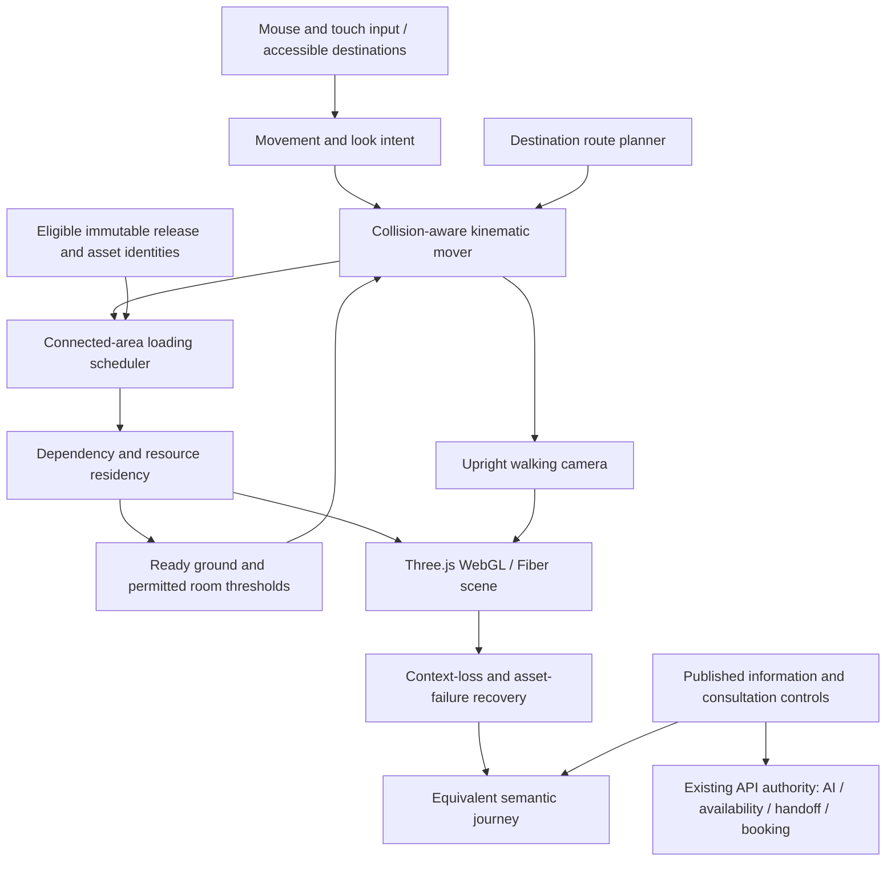

# Original campus asset build specification — v1

Status: DOING. Proposed 2026-10-05 under D-064–D-067/D-071 and TASKS Phase 1
deliverable 7. This defines the production authoring/export work; it does not
authorize application development, production modeling, another study revision,
new dependencies, external assets, spend, publication or deployment.

The initial independent review attempt failed with “Your workspace is out of
credits. Add credits to continue.” It produced no receipt or verdict. This draft
remains unreviewed; the subsequent founder-directed research and proposal below
do not count as another model revision or authorize self-approval.

## Accepted starting point and observed cause

D-071 accepts the central reception, five-wing arrangement and connected
landscape of the [final-third layout study](../../artifacts/nature-campus-layout-study/README.md).
Preserve that exact master, generator and export. Carry its architectural
composition forward rather than replacing it with generic huts or a different
campus. The [selected concept](concepts/nature-campus-direction-2026-10-04.png)
guides unfinished materials and nature integration; it is artistic reference,
not measured building geometry or an environmental-performance claim.

The [asset manifest](asset-manifest.json) inventories the unchanged GLB's 117
mesh nodes in 15 proposed authoring families, their exact source identities and
canonical wing/room references. All 117 nodes are scene roots, with 117 meshes,
16 materials and no images, textures, animation, skins or cameras. Grouping
those nodes here creates no chunk files, instancing, collision or runtime.
The source generator batches geometry by name/material; forest and garden
groups span the scene rather than loading by area. The 20,860,132-byte whole
uncompressed export is larger than the accepted initial transfer ceilings before
adding textures; no optimized delivery variant or measured transfer pass exists.

The unchanged GLB JSON contains 117 triangle primitives, 726,056 triangles,
569,809 exported POSITION entries and 20,777,088 bytes across distinct geometry
bufferViews. The inventory owns the exact per-family breakdown and calculation
method. POSITION entries are not welded unique vertices; these stored bytes are
not measured CPU/GPU memory, and primitive count is not runtime draw calls.

| Observed family | Triangles | Referenced geometry bufferView bytes | Engineering implication |
|---|---:|---:|---|
| Vegetation | 513,632 | 14,199,192 | About 70.7% of triangles and 68.3% of geometry bytes. Prioritize reusable plant families, spatial instances/batches and detail variants; do not carry a single campus-wide merged forest into production. |
| All five wings together | 111,960 | 3,749,112 | Preserve distinct silhouettes while separating interiors and shared parts. The five volumes do not establish five finished departments or room-ready collision. |
| Landscape | 40,386 | 796,236 | Ground/river and distant terrain need separate visibility and readiness responsibilities. Rebuilding safe terrain connections is not justified solely by a triangle count. |

This evidence chooses the first asset-pipeline investigation, not a universal
triangle budget or performance diagnosis. Preserve the study and derive the
separate production master from its accepted composition after the applicable
approval. Measure geometry, textures, overdraw, shadows, scripting and transient
loading together; fewer triangles alone cannot certify an enterprise result.

The viewer uses `OrbitControls`, preset camera/target pairs and target-centred
zoom. Its terrain is finite; the viewer supplies a flat background colour and
fog. This explains the founder's island-like impression and fixed-centre zoom.
Panning in the inspector does not implement the accepted walking journey.
No horizon, finished scenery or eye-level walking behavior is certified by the
three inspection cameras. Their controls are evidence of the study only.

## Spatial and visual result

Refine the founder's latest direction as a continuous-looking inhabited valley:
coherent near, middle and distant landscape, a believable sky/horizon and complete
surroundings in every permitted viewing direction. Avoid exposed terrain edges,
a blank rear of the campus, a pasted mountain wall, abrupt scenery seams or a
floating-island presentation on the accepted visitor routes. This extends
unfinished environment detail; it does not reopen the accepted building layout.

The production World uses an eye-level walking viewpoint with free look and
mouse/touch movement plus destinations under the [World controls](WORLD_EXPERIENCE.md#movement-and-access).
Look-around is not a requirement for unrestricted flying, underground viewing,
camera roll or infinitely walkable terrain. Safe pitch/camera clearance and
movement limits require the approved controls/reference; no numerical values are
selected here. Inspector overview/orbit cameras must not become the only way to
explore. A zoom gesture must have an explicitly designed role rather than silently
orbiting a remote centre or teleporting across unready ground.

Near-field geometry supplies walkable ground, entrances and details. Middle-field
architecture and vegetation preserve the reception hierarchy and five distinct
wing proportions. Distant terrain/scenery supplies all-around depth and silhouettes
with simpler variants; distant backdrop is not collision-ready or a travel promise.
Sky, lighting, atmosphere, materials and distant variants must belong to one
coherent art direction, match interiors/exteriors and preserve accepted interface
contrast. Compare eye-level views through a complete permitted look-around as
well as Overview, Arrival and Department; three flattering frames are insufficient.

## Authoring families and canonical binding

The manifest's IDs group study observations only; they are not new public artifact
keys or an accepted runtime chunk schema. glTF node indices are meaningful only
within the exact source digest, and names are not general unique identifiers.

| Family | Production work and boundary |
|---|---|
| Arrival | Continuous approach into reception; ground, threshold and landscape context. |
| Reception | Largest welcome volume, branching supports, connected exits and truthful information/help access. |
| Five wings | Preserve formal titles and composition; author interiors for each canonical service-room destination instead of reusing an unrelated generic room. |
| Five connectors | Connect the reception and each wing at compatible transforms/floor levels; both east-side crossings retain coherent banks, decks, piers and rails. |
| Landscape | Subdivide connected ground, river/banks and distant terrain without cracks, missing safe ground or a new mountain-wall composition. |
| Vegetation | Reusable authored plants/trees with variation, spatial batches, bounds and detail variants; the current merged forest is not an instance library. |
| Department fixture | Strategy board/seating is a representative study fixture. Generalize approved interaction anchors without opening Strategy first or representing staff as present. |

The [wayfinding release map](../phase-1-ux-architecture/wayfinding-release-map.csv)
controls wing keys, service rooms and opening order: AI + Data, Strategy,
Immersive + Creative, Digital + Growth, Cloud + Reliability. A modeled room,
manifest entry or release ordinal cannot activate content or permit traversal.
Eligible publication controls every public panel, source, room and help action.
Use the reviewed availability/handoff contracts; no baked sign, decorative
person, desk or lighting state can assert a human is online or has accepted.

## Editable master and export contract

After the applicable approval, author a separate production master from the
accepted basis with named collections for architecture/interiors, landscape,
shared families, collision/safe ground, interaction anchors and review cameras.
Keep one documented campus coordinate frame; each later chunk has an explicit
local origin and placement transform. Do not merely detach world-baked meshes
and reset origins, which could move buildings or disconnect floor seams.

The study declares one Blender unit per metre, with Blender Z up. Its plan maps
to glTF X/-Z with Y up. This declaration does not establish approved human scale,
floor dimensions or clearance. Resolve those dimensions before navigation authoring;
verify transformed positions, normals, winding, bounds and seams on reimport and
in the chosen renderer. Keep source contour inputs distinct from measured geometry.

Author collision/safe-ground surfaces separately from visual foliage, glass,
water and decorative meshes. Collision readiness includes entrances, steps/slopes,
edge/water exclusion, body clearance and connectors; finite centreline ray samples
are not a swept-body or continuous-route proof. Threshold state must prevent entry
into closed, missing or ineligible rooms. Collider detail cannot be removed solely
because a distant visual LOD is simplified.

Use glTF 2.0 PBR with correctly interpreted colour versus data textures, normals,
UVs and supported material extensions. Timber, earth/mineral surfaces, planted
roofs, glazing and foliage must read consistently under the approved lighting.
Control transparency/overdraw, shadow cost, texture resolution/mipmaps, material
count and draw submissions within measured stream budgets. Baking, image-based
lighting and lightweight distant variants are candidate techniques, not a selected
pipeline. No expensive reflection, postprocessing or shader package is mandated
merely by the founder's enterprise-quality requirement.

Evaluate stable supported mesh compression, KTX2/Basis texture delivery, batching
and instancing against visual fidelity, decoder dependencies, build compatibility,
decode/transcode cost and target browsers. These are candidate choices; none is
selected or downloaded here. Missing extension/decoder support needs an approved
compatible variant or semantic recovery, never a partially rendered unsafe world.
Confirm every exporter/loader/decoder version in the complete latest mutually
compatible stable graph; WebGL remains production and WebGPU experimental only.

## Loading, resource lifetime and failure

Export arrival, reception, eligible wings/interiors and connected landscape as
separately accountable immutable assets with shared dependencies. Exact borders,
variant selection, dependency graph and artifact keys require review and measured
budgets. The public [publication contract](../phase-1-architecture/contracts/PUBLICATION_CONTRACT.md)
owns release identity, checksums and eligibility; this internal inventory cannot
be served in its place or become a second content database.

Load ready current space, connected neighbors and a bounded recently traversed
buffer so a quick reversal does not reveal missing ground. Prioritize safe ground
and the requested route over distant decoration. Bound concurrent transfers,
decode/transcode work and GPU uploads; obsolete work cannot attach after navigation,
release loss or exit. Cancellation/fencing must cover late completion even where
the chosen decoder cannot stop immediately. Readiness is more than download success:
verify exact bytes, eligibility, transform/dependencies and required collision
before movement can enter. Loading a chunk never enables audio or live assistance.

Use spatially bounded instances/batches and appropriate visual LOD/culling. Correct
bounds must cover all instances/variants; a giant scene-wide batch defeats useful
spatial culling. Culling reduces submitted rendering work but does not release
resident memory. Keep approved stream selection/lock separate from within-stream
detail; optimization cannot silently switch streams or remove essential destinations.

Track ownership of geometry, materials, textures, render targets, decoder resources
and optional audio. Shared dependencies survive eviction while another ready area
uses them; final-owner release/exit disposes them explicitly. Account for CPU and
GPU resources separately, including transient peak decode/upload cost. Context
loss or allocation failure stops affected travel, preserves semantic recovery
and restores only currently eligible ready state. Backgrounding, panel focus,
pointer cancellation and Exit retain their accepted movement/audio rules.

## Provenance, inspection and acceptance

The observed generator uses original procedural geometry/material construction
without Atlanta or downloaded library inputs. That observation is not commercial
rights or ownership clearance. Preserve its source and provenance; register every
later texture, plant, rock, audio or other external input with exact source,
license, commercial modification/redistribution/attribution obligations and reviewed
evidence. Unresolved rights hold the affected asset. No paid asset is selected.

| Stage | Required result before its applicable acceptance |
|---|---|
| Definition | Canonical room bindings, accepted composition, authoring/export/resource/failure specification, proposed dimensions/control references and evidence-backed budget definitions independently reviewed; full Phase 1 founder approval remains separate. |
| Export inspection | Exact exporter/settings/source/asset identities; glTF Validator errors resolved and warnings dispositioned; supported extensions, dependencies, transforms and all-around same-model views inspected. Validator success does not prove appearance or safe movement. |
| Runtime asset journey | Actual arrival → reception → first eligible wing → help/Book; look-around, reverse, cold/warm entry, eviction/reentry, corruption, missing dependency, late completion, context loss and release withdrawal preserve safety and semantic parity. |
| Performance and appearance | Named computers and physical phones; accepted initial ≤8 MB/≤4 MB and incremental room ≤5 MB/≤2.5 MB transfer ceilings with defined units/cache accounting; approved NFR-007 frame-time/memory/sustained limits, fidelity and detailed founder appearance acceptance. No inherited FPS or byte-per-tree estimate. |

Implementation-boundary observations occur after the corresponding implementation
is authorized; stating them here does not claim execution or waive Phase 1 inputs.
Exact dimensions/clearances, gestures/screens, chunk borders, resource/numerical
limits, complete compatible exporter/loader graph, asset rights, detailed appearance
and integrated acceptance remain held. This specification supplies no production
model, working camera/controller, streaming, audio or completed enterprise result.

## Primary guidance checked 2026-10-04–2026-10-05

Context7 `/websites/blender_manual_en` and `/websites/threejs` were consulted for
glTF export, shared data/instances and loader/decoder/resource constraints. The
[Blender glTF manual](https://docs.blender.org/manual/en/latest/addons/scene_gltf2.html)
was returned by Context7; direct web retrieval failed, so no second successful
direct fetch is claimed. The [Khronos glTF specification](https://registry.khronos.org/glTF/specs/2.0/glTF-2.0.html)
supports coordinate, transform and format rules; the [official validator](https://github.khronos.org/glTF-Validator/)
is a later inspection candidate, not an executed validation in this slice.
[Three.js GLTFLoader](https://threejs.org/docs/pages/GLTFLoader.html) identifies
supported extensions and decoder integrations. [MDN WebGL guidance](https://developer.mozilla.org/en-US/docs/Web/API/WebGL_API/WebGL_best_practices)
supports capability/limit checks, batching, compressed textures, resource deletion
and avoiding blocking hot-path calls. Project decomposition and safety/quality
acceptance above are Hengshi requirements, not guarantees conferred by those sources.
No observed tool or current documentation version selects the production graph.

## Researched engineering recommendation

The founder supplies the experience/vision; the producer translates it into
technical choices, checks alternatives and proposes a buildable solution rather
than assuming the founder's terminology is an engine design. The following is
a recommendation for independent review and founder consideration, not selected
dependencies or permission to implement. Retain D-065's approved authority map;
this describes the 3D client and asset pipeline inside those boundaries.

| Responsibility | Recommended approach | Tradeoff and evidence to settle |
|---|---|---|
| Renderer and application integration | Retained React Three Fiber + Three.js WebGL within the React/TypeScript site; core engine loaders/instancing before extra wrapper libraries | A supported web renderer serves this campus without changing engines. Complete React/Three/Fiber/Drei/exporter/decoder compatibility still needs resolution, runtime proof and locks. |
| Walking and camera | Separate mouse/touch input, upright look camera and a collision-aware kinematic mover; evaluate Rapier 3D's existing character controller first | Shape-based movement accounts for body clearance better than a single floor ray. Rapier adds WASM/runtime resources and needs a measured spike; its controller handles translation, so camera rotation and application safety rules remain separate. No example slope, step, offset or speed is adopted as a default. |
| Clicked destinations | Route across authored ready walkable ground; evaluate baked Recast/Detour navigation data if route planning needs it | A navigation mesh plans a route; it does not prove body collision, room eligibility or loaded ground. Evaluate a lightweight authored route graph before adding a second WASM library. A direct straight line through walls or water is unacceptable. |
| Spatial loading | Campus connectivity graph plus spatial bounds, a prioritized dependency scheduler and a separate resident-resource registry | Room/connector topology suits this bounded campus. Need measured borders, concurrency and reversal buffers; a general planetary/geospatial terrain engine is not presently justified. Visibility, download completion and movement readiness remain distinct. |
| Landscape and horizon | Coherent near/middle/distant terrain and all-around silhouettes with a consistent sky/lighting treatment; evaluate the engine Sky helper or a rights-cleared sky asset | A sky alone cannot conceal badly authored terrain edges or supply mid-ground depth. Atmospheric shaders, panoramas and lighting have different fidelity, memory and compatibility costs; choose through same-model look-around and physical-device tests. |
| Asset compilation | Editable Blender masters → separate glTF assets → evaluated offline optimization → glTF validation and visual reimport | Evaluate glTF Transform for repeatable pruning/deduplication/partitioning and supported compression. Optimization must preserve authored transforms, anchors, collision semantics and appearance; never flatten away identities required by publication or room mapping. |
| Render scheduling | Render while movement/approved ambience requires it; permit resting scenes to render on demand with explicit invalidation | Fiber's demand mode can save idle work, but mutations/animations need scheduled invalidation. No unbounded frame loop or a stale camera caused by an unsignalled imperative change. This is not a promised FPS gain. |
| Content and consultation | Semantic controls/panels use the same eligible publication and canonical routes; availability, AI, handoff and booking remain server-authoritative | No scene mesh, navmesh, loaded tile, GPU cache or library can grant access, publish a claim, assert staff presence or confirm a booking. |

Proposed client decomposition is logical, not a folder move or added deployable:

Scheduler readiness is a proposed controlled sequence: permitted request →
bounded verified bytes → parsed/transcoded dependencies → GPU resources →
collision/ground and required interaction readiness → attached ready area.
Any failed, superseded or ineligible stage cannot attach or become traversable.
This is not the publication or booking state machine and does not grant their
authority. Retry/reversal must reuse safe resident resources without accepting
an earlier release or extending eligibility. Shared dependencies are reference-
owned; exact lifecycle/state/error definitions remain a later reviewed contract.

Proposed scheduling and ownership rules for that later contract:

1. Distinguish required safe ground/current interaction from requested travel,
   connected-neighbor/reversal preparation and distant decoration. A distant asset
   cannot displace ground required by a live visitor or an active threshold.
2. Key reuse by immutable asset identity and the selected compatible variant;
   scope attachments and pending work to the current eligible visit generation.
   Shared bytes can be reused only when the current manifest references them.
   Resource reuse is not continued release eligibility or access permission.
3. Count pending transfer, CPU decode, GPU preparation and resident ownership
   separately. Deduplicate a shared dependency request, retain its live owners
   and avoid releasing it when only one dependent room is evicted.
4. Reversal changes priorities and retains safe recent ground within the approved
   budget. Direction prediction is an optimization; it cannot be the only source
   of surrounding scenery or readiness behind the visitor.
5. A late result first checks its generation, identity, variant and current owners.
   Superseded or no-longer-owned work is discarded/released before attachment.
   A successful download cannot override a failed collision or permission check.
6. Admit a prepared area at a controlled frame boundary. During travel, the mover
   uses the ready collision context; the renderer and thresholds use its matching
   transforms and eligible content. Partial upload cannot create traversable space.
7. If required residency exceeds its measured envelope, stop at the last safe
   position and offer retry/destination/semantic recovery. Do not evict the current
   floor, silently change streams or keep allocating without a bound.

These rules refine the existing F3D-04–F3D-07/F3D-14 requirements. They create no
new public API, persistent trajectory record or provider selection. Exact class
schemas, worker arrangement, concurrency, duration, distance and memory settings
must be evaluated in the authorized representative implementation spike rather
than copied from a library demonstration or invented as measured facts.

Build the authorized representative slice in this order: resolve scale and input
reference; prove arrival/reception/first-wing walking and destination collision;
prove late/cancelled loading and reverse travel; compare all-around architecture,
sky and depth; add materials/vegetation/sound within measured budgets; integrate
real eligible content/help/booking; validate and independently review; expand
the remaining accepted wings. This sequence neither changes their opening order
nor bypasses full Phase 1 approval. Plan/task generation and application work
wait for reconciled approved requirements; proposed libraries are not installed.

Additional primary research checked 2026-10-05:
[Rapier character controller](https://rapier.rs/docs/user_guides/javascript/character_controller/),
[Recast navigation bindings](https://docs.recast-navigation-js.isaacmason.com/),
[Fiber performance guidance](https://r3f.docs.pmnd.rs/advanced/scaling-performance),
[Three.js instancing](https://threejs.org/docs/pages/InstancedMesh.html),
[OrbitControls](https://threejs.org/docs/pages/OrbitControls.html),
[Sky helper](https://threejs.org/docs/pages/Sky.html) and
[glTF Transform](https://gltf-transform.dev/). Context7 `/dimforge/rapier.js`
was consulted for controller constraints. Do not use preview `/next/` framework
guidance or a documentation example as a production version/default selection.
